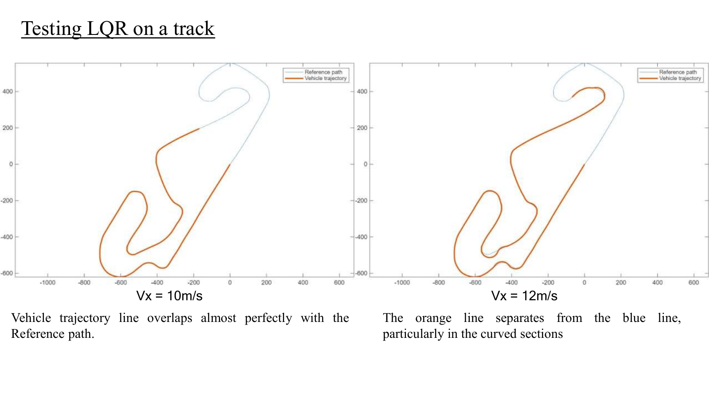
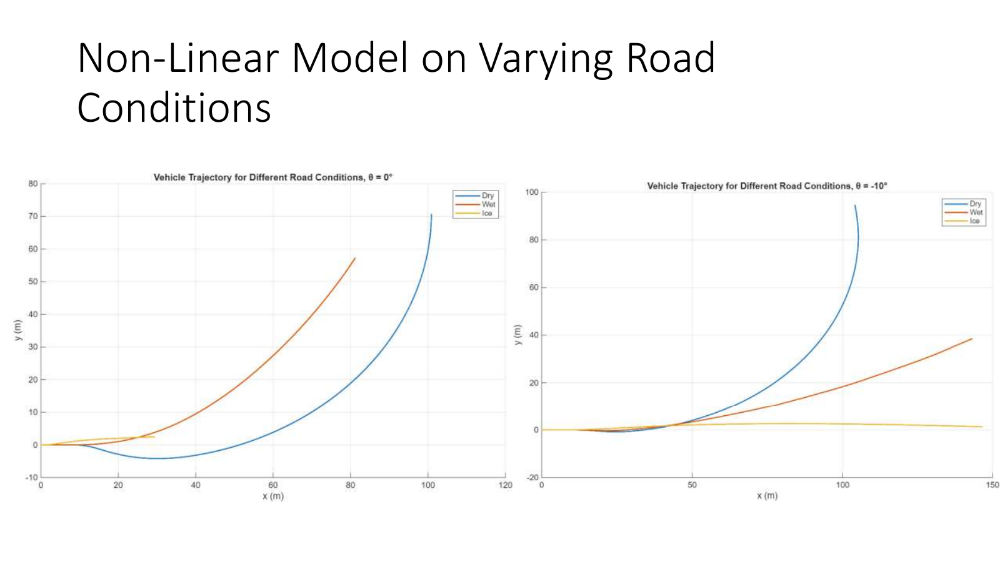
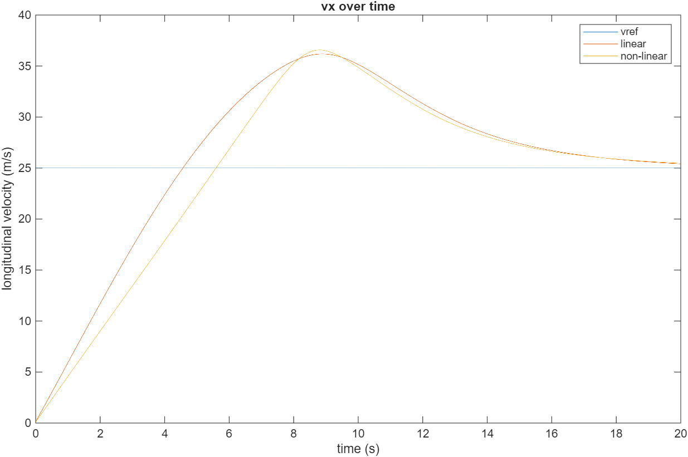
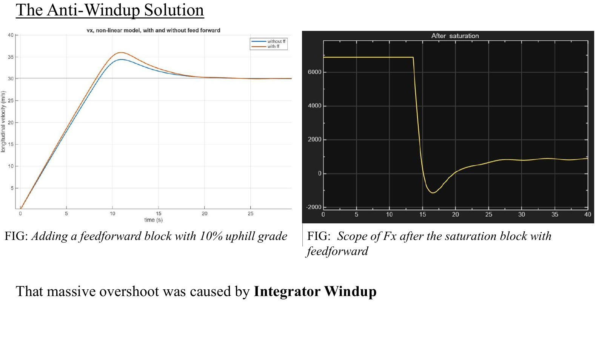
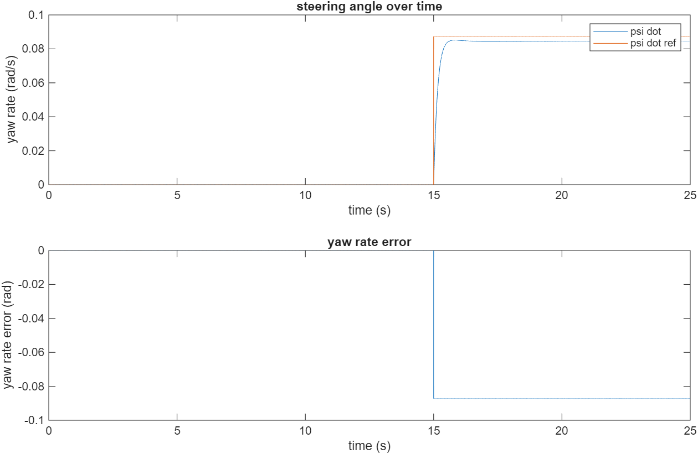
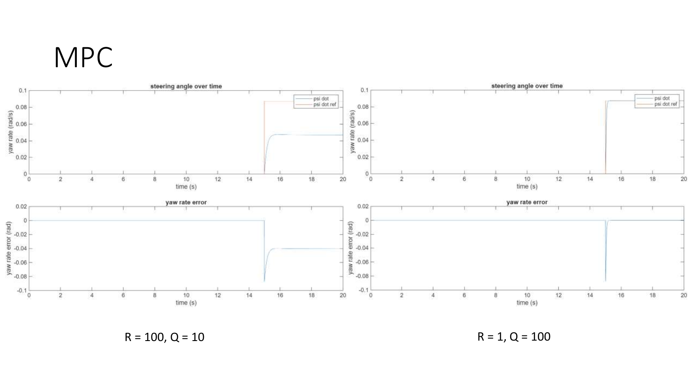

# Vehicle Dynamics and Control - Bicycle Model, PI, LQR and MPC

**MATLAB/Simulink | Smart Transportation Lab | Team: Zhuoran Dong and Yonatan Tamiru Asfaw**

Academic investigation of coupled longitudinal and lateral vehicle dynamics, using linear and nonlinear bicycle models, PI speed regulation with feedforward, LQR lateral control and constrained MPC yaw-rate tracking.

## Explore the results

| Study | Evidence and finding |
|---|---|
| [Linear vs nonlinear model](#linear-and-nonlinear-dynamics) | Speed, longitudinal force, yaw, sideslip and trajectory comparisons |
| [Road-condition scenarios](#road-condition-scenarios) | Dry, wet and ice responses at five labelled slope angles |
| [PI and feedforward](#pi-speed-control-feedforward-and-windup) | Fast target crossing, significant overshoot, slope compensation and saturation effects |
| [LQR tuning and track following](#lqr-tuning-and-speed-sensitivity) | Near-reference tracking at 10 m/s; degradation in curves at 12 m/s |
| [MPC tuning](#mpc-yaw-rate-control) | Tracking-versus-steering-effort trade-off with constrained steering |
| [Project presentation](smart%20transportation.pdf) | Original 12-page presentation |

## Linear and nonlinear dynamics

The source parameter file describes a Renault Megane model with **mass 1,400 kg**, yaw inertia **1,960 kg m²**, and CG-to-axle distances **1.177 m (front)** and **1.358 m (rear)**. These are model settings, not experimentally identified vehicle parameters.

| Longitudinal comparison | Lateral response comparison |
|---|---|
|  |  |

The saved plots compare model responses rather than road-test measurements. The nonlinear formulation and tyre/force saturation are relevant when road adhesion or manoeuvre intensity changes.

## Road-condition scenarios

The supplied collection contains **five labelled road angles (-10°, -5°, 0°, 5°, 10°)**, each comparing **dry, wet and ice** conditions. Angle in degrees must not be confused with percentage grade; the separate speed-control presentation describes a **10% uphill grade**.

| Labelled road angle | Original trajectory plot |
|---|---|
| -10° | [Dry / wet / ice](Smart_Transportation_lab/Q5%20-%20non-linear%20vehicle%20trajectory%20for%20different%20road%20conditions%20theta%28-10%29.png) |
| -5° | [Dry / wet / ice](Smart_Transportation_lab/Q5%20-%20non-linear%20vehicle%20trajectory%20for%20different%20road%20conditions%20theta%28-5%29.png) |
| 0° | [Dry / wet / ice](Smart_Transportation_lab/Q5%20-%20non-linear%20vehicle%20trajectory%20for%20different%20road%20conditions%20theta%280%29.png) |
| 5° | [Dry / wet / ice](Smart_Transportation_lab/Q5%20-%20non-linear%20vehicle%20trajectory%20for%20different%20road%20conditions%20theta%285%29.png) |
| 10° | [Dry / wet / ice](Smart_Transportation_lab/Q5%20-%20non-linear%20vehicle%20trajectory%20for%20different%20road%20conditions%20theta%2810%29.png) |

**Observation:** the plotted trajectories diverge across adhesion conditions, with particularly different motion on ice. These are model-response comparisons; a common reference path or aggregate tracking-error metric is not supplied for this sweep. They should not be presented as successful tracking in all 15 combinations.

## PI speed control, feedforward and windup

The reference is **25 m/s**. Both model responses cross the reference within 10 s but overshoot substantially (the plotted peak is around 36 m/s). Reaching the target is not the same as settling at it; no verified settling-time or exact overshoot metric is inferred from this figure.

The presentation studies gravity compensation on a **10% uphill grade** and attributes a large transient to integrator windup. The anti-windup-labelled response returns towards about **30 m/s**, while the force scope illustrates actuator saturation and the subsequent release. The feedforward curve still overshoots; these figures do not establish an overshoot-free controller or a quantified percentage improvement.

[Original anti-windup response](Smart_Transportation_lab/Q5_with_anti_windup.png) · [Lower-gain comparison](Smart_Transportation_lab/Q5_feedforward_lower_gains_scope.png) · [Saturated force trace](Smart_Transportation_lab/Q5_after_saturation_scope.png)

## LQR tuning and speed sensitivity

**Reported result:** at **10 m/s**, the vehicle trajectory closely overlaps the reference. At **12 m/s**, separation appears particularly in curved sections. This demonstrates speed sensitivity in the supplied configuration, not a universal 12 m/s stability boundary.

The presentation compares `Q = 10, R = 1` with `Q = 1, R = 10`. Under the standard LQR cost, **Q penalises state deviation and R penalises control effort**. Higher Q relative to R prioritises state regulation; higher R discourages control effort. This corrects the swapped explanatory wording on the original tuning slide without altering its plots.

| State-weighted case | Effort-weighted case |
|---|---|
|  |  |

Additional saved trials include [sinusoidal yaw-rate error](Smart_Transportation_lab/LQR_sin_yaw_rate_ref_error.png) and its [trajectory](Smart_Transportation_lab/LQR_sin_yaw_rate_ref_trajectory.png). These show individual test runs, not a statistical controller benchmark.

## MPC yaw-rate control

The presentation compares **Q = 10, R = 100** with **Q = 100, R = 1**. The higher tracking-weight case follows the illustrated yaw-rate step more closely, while the effort-weighted case retains a visible offset. The upper plots have a generic steering-title label but their axes/legends identify yaw rate; the caption here follows the plotted signal.

The supplied `MPC_script.m` uses a **15-step prediction horizon**, a steering limit of **±25°**, parameterised discrete A/B matrices, and YALMIP with `quadprog`. These are source-code settings, not proof of measured computation time or constraint satisfaction in every saved plot. No exact RMS, settling-time or runtime improvement is claimed without the underlying logs.

## Repository layout and setup

- `Smart_Transportation_lab/`: original MATLAB scripts, `VehicleDynamics.slx`, `Track.mat`, and saved result figures.
- `smart transportation.pdf`: academic presentation.
- `results/`: four page renders of the original presentation, used to retain labelled comparisons and context.

MATLAB and Simulink are required. MPC may require YALMIP and a compatible optimisation solver; the supplied script selects `quadprog`. Obtain YALMIP from [its original project](https://yalmip.github.io/) and retain its license/citation terms. The bundled dependency source, caches and autosaves remain excluded.

Inspect parameters, paths and workspace assumptions before running. No models or scripts were executed for this documentation update, and exact MATLAB-release compatibility is unverified. One local PNG (`Q5_feed_forward_scope.png`) is empty and is not used as evidence.

## Attribution and provenance

The presentation credits **Zhuoran Dong and Yonatan Tamiru Asfaw**. Existing source notices are retained and no new software license is assigned. Original chart files stay unchanged. `results/report-page-4.png`, `7.png`, `9.png` and `10.png` are direct page renders of the supplied presentation; they are not new experiment results. The gallery distinguishes reported observations, visual approximations and code settings so the portfolio does not imply unsupported hardware performance.
