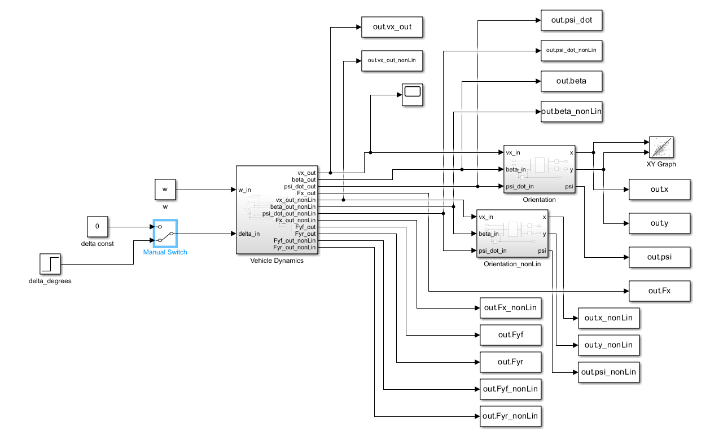

# Vehicle Control: PI, LQR and MPC

Academic MATLAB/Simulink project investigating longitudinal and lateral vehicle dynamics with a bicycle model, PI control with feedforward, LQR and MPC.

## Layout

- `Smart_Transportation_lab/`: supplied MATLAB scripts, Simulink model and result figures.
- `smart transportation.pdf`: project presentation.

The original project filenames and relative directory structure are preserved. Generated MATLAB caches, autosaves, a redundant nested archive and the bundled YALMIP source tree were omitted.

## Requirements

MATLAB and Simulink are required. The MPC work may also require YALMIP and a compatible optimisation solver. Obtain YALMIP from its original project, follow its installation instructions, and retain the upstream license and citation requirements: https://yalmip.github.io/

Inspect script parameters and model dependencies before running. No scripts or models have been executed during this preparation, and the precise MATLAB release/toolbox requirements remain to be verified.

## Reported results and limitations

The presentation shows close overlap between the reference and LQR vehicle trajectories at 10 m/s. It also reports deterioration in curved sections at 12 m/s. The initial PI acceleration plots show significant overshoot; reaching 25 m/s in less than 10 seconds should not be described as settling within that time.

## Contributors and attribution

The presentation credits Zhuoran Dong and Yonatan Tamiru Asfaw. Existing source notices are retained. No new software license has been assigned, and dependency code is not presented as the students' original work.
